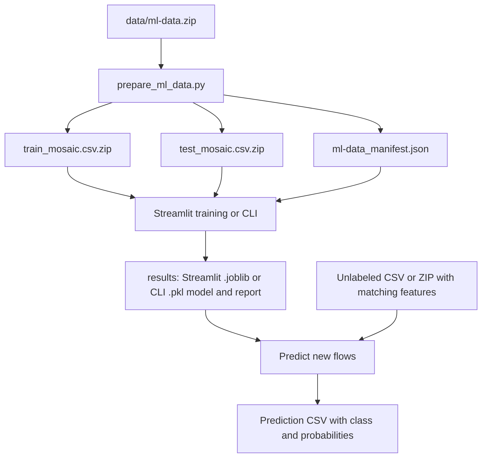

# Malicious Traffic Detection ML — Detailed Guide

This guide explains how to install, run, and understand the malicious network-traffic detection project. The existing `README.md` remains the short overview; this file provides a more complete reference.

## 1. What the project does

The project trains supervised machine-learning classifiers to distinguish traffic classes from labeled network-flow features. It includes:

- A Streamlit web interface for exploring data, training models, and reviewing results.
- A command-line interface (CLI) for running the existing pipeline.
- Optional feature transformations, hyperparameter search, and cross-validation.
- A bounded preprocessing step for the supplied `data/ml-data.zip` archive. The synthetic generator is kept separate and is not used by the app or CLI.

This is a research/demo pipeline, not a real-time network monitor. It does not capture packets or automatically block traffic. Model quality depends on representative, correctly labeled data.

## 2. Project files: inputs, outputs, and responsibilities

| File or path | Inputs | Outputs | Role |
| --- | --- | --- | --- |
| `data/ml-data.zip` | Supplied archive containing CSV members. | None; treated as immutable source data. | Sole source for labeled training/evaluation data. The archive is not extracted wholesale. |
| `prepare_ml_data.py` | `data/ml-data.zip`; fixed sample limits and random seed in the script. | `data/train_mosaic.csv.zip`, `data/test_mosaic.csv.zip`, `data/ml-data_manifest.json`. | Normalizes headers, skips damaged ZIP members, removes IDs/text, maps labels to `BENIGN`/`MALICIOUS`, cleans numeric values, balances, and splits. |
| `data/train_mosaic.csv.zip` | Generated by `prepare_ml_data.py`. | Loaded by the Streamlit training workflow and CLI loader. | Prepared labeled training rows: 81 numeric features plus `label`. |
| `data/test_mosaic.csv.zip` | Generated by `prepare_ml_data.py`, with the same feature schema as training. | Used only for held-out evaluation by the app/CLI. | Prepared labeled test rows. |
| `data/ml-data_manifest.json` | Metadata recorded by `prepare_ml_data.py`. | Read by `app.py`; also available for inspection. | Records source archive, sampling limits, seed, feature list, included/skipped members, and split/class counts. The app refuses to train if this does not identify `ml-data.zip`. |
| `app.py` | Prepared train/test ZIPs and manifest for training; a saved `ml_data_` model plus an unlabeled CSV/ZIP for inference. | `results/ml_data_*_model.joblib`, reports, test predictions, and batch-inference CSVs; charts are rendered in the UI. | Streamlit front end for data exploration, fitting/evaluation, and batch prediction. Training is locked to the prepared `ml-data` split. |

| `src/cli.py` | Algorithm, feature-engineering, tuning, and CV command-line arguments. | Logs and a call to `src/main.py`. | CLI argument parsing and entry point. |
| `src/main.py` | CLI options and prepared train/test DataFrames from the loader. | Fitted pipeline, metrics, and evaluation artifacts. | Orchestrates the command-line training/evaluation path. |
| `src/config.py` | Project location. | `DATA_DIR`, `RESULTS_DIR`, model definitions, and feature-option mappings. | Shared configuration used by the CLI and its pipeline. |
| `src/utils/data_preprocessing.py` | `data/train_mosaic.csv.zip` and `data/test_mosaic.csv.zip`. | Full train/test DataFrames with invalid numeric values checked. | Reads the prepared files for CLI runs; it no longer randomly truncates them to fixed row counts. |
| `src/utils/feature_engineering.py` | Selected transformation name. | A scikit-learn transformer or `None`. | Defines scaling, PCA, polynomial, and feature-selection steps. |
| `src/utils/model_training.py` | Estimator, transformer, training features/labels, and search settings. | A scikit-learn pipeline; optionally its tuned estimator and best parameters. | Builds and fits model pipelines and performs randomized search. |
| `src/utils/evaluation.py` | Fitted pipeline, held-out test data, and optional training data for CV. | Accuracy/CV results, `ml_data_*_model.pkl`, and text reports under `results/`. | Evaluates and saves CLI models. CV runs on training data only when requested. |
| `src/__init__.py`, `src/utils/__init__.py` | Python imports. | Importable package namespaces. | Mark the source directories as Python packages. |
| `generate_synthetic_data.py` | Fixed random seeds and synthetic feature-generation settings. | Demo ZIPs under `data/synthetic_demo/`. | Isolated demo utility; neither app nor CLI reads its output. It cannot overwrite the prepared `ml-data` files. |
| `results/` | Trained models and prediction/evaluation outputs from the app or CLI. | Persistent model, report, and prediction artifacts. | Output directory. The prediction UI only lists model files with the `ml_data_` prefix, excluding older models from other data. |
| `requirements.txt` | Python/pip. | Installed runtime packages. | Declares ML, Streamlit, and visualization dependencies. |
| `example_usage.sh` | None. | Prints example CLI commands. | Reference script only; it prints examples rather than running them. |
| `Dockerfile` | `requirements.txt` and `src/`. | Container image. | Currently copies the CLI source only and defaults to CLI help; it is not configured to serve the Streamlit UI. |
| `docker-compose.yml` | Dockerfile/image and local data/results directories. | CLI container invocation with mounted data/results. | Container orchestration. Data is mounted read-only and results read/write. |
| `.dockerignore` | Container build context. | Excluded build-context files. | Excludes local `data/` and `results/`; they are mounted by Compose instead. |
| `.gitignore` | Git working tree. | Excluded local files. | Keeps datasets, prepared files, models, and results out of normal Git tracking. |
| `README.md`, `README_DETAILED.md` | Project behavior and usage. | User documentation. | Short overview and detailed workflow/I/O reference, respectively. |
| `LICENSE` | License text. | Usage and redistribution terms. | Defines the project license. |

### End-to-end workflow



1. **Prepare:** run `python prepare_ml_data.py`. It reads only the supplied archive, samples at most 100,000 rows from each readable CSV member, and generates a balanced labeled sample. The current output is 14,684 training rows and 3,672 test rows, each with 81 numeric features and an equal class split.
2. **Train/evaluate:** Streamlit or the CLI reads those two prepared ZIPs. The target is the final `label` column (`BENIGN` or `MALICIOUS`); the app checks the manifest before fitting. The test split is held out for evaluation.
3. **Save:** fitted models and evaluation reports are written to `results/` with an `ml_data_` prefix. Older results remain on disk but are excluded from the app's model selector.
4. **Infer:** in Streamlit choose **Predict new flows**, choose a saved `ml_data_` model, and upload unlabeled flow rows with exactly the same 81 feature names. The app aligns column order, applies numeric cleanup, predicts classes and (when available) class probabilities, then saves/downloads a prediction CSV.

The preparation is deliberately bounded, not a full scan of the archive: the archive expands to roughly 31 GB, and five of its 18 CSV members have invalid local ZIP headers. Those five are recorded as skipped in the manifest; the original ZIP remains unchanged. Metrics from the random split of this bounded sample can be optimistic and should not be treated as production performance.

## 3. Installation and launch

### Recommended: run locally without Podman or Docker

From PowerShell, change to the project folder and install dependencies:

```powershell
cd C:\Users\hp\Downloads\malicious-traffic-detection-ml
python -m pip install -r requirements.txt
```

Prepare the supplied archive once, then start the web UI:

```powershell
python prepare_ml_data.py
python -m streamlit run app.py
```

Open the URL printed by Streamlit, normally `http://localhost:8501`. Stop the app with `Ctrl+C` in the terminal.

If the `streamlit` command is not recognized, using `python -m streamlit` as above avoids relying on the Scripts directory being on `PATH`. If Python cannot import Streamlit, rerun the dependency installation command.

### Command-line interface

The CLI uses the same prepared `ml-data.zip`-derived train/test files as the Streamlit training workflow. It can be run separately:

```powershell
python -m src.cli --algorithm "Random Forest" --feature-engineering "PCA"
```

Available algorithms are `Naive Bayes`, `Decision Tree`, `Logistic Regression`, and `Random Forest`. Available feature engineering options are `None`, `Standard Scaling`, `Min-Max Scaling`, `PCA`, `Polynomial Features`, and `SelectKBest`.

Add the optional flags for hyperparameter search and cross-validation:

```powershell
python -m src.cli --algorithm "Random Forest" --feature-engineering "PCA" --tune-hyperparameters --cross-validation
```

Use `python -m src.cli --help` to see the CLI's current arguments.

## 4. Data requirements

### Supported input

The application trains only from `data/train_mosaic.csv.zip` and `data/test_mosaic.csv.zip`, which are generated from `data/ml-data.zip` by:

```powershell
python prepare_ml_data.py
```

The source archive has 18 CSV members. Five members have invalid ZIP local headers and are skipped; the original archive is not modified. Reading the entire archive would expand roughly 31 GB, so preparation is bounded and reproducible: it reads at most the first 100,000 rows per readable member, samples at most 2,500 rows of each class per member, balances the final labels, and creates a stratified 80/20 split. This is not a full scan of the archive; the prefix-based sampling limitation is recorded in `data/ml-data_manifest.json`.

Preparation strips surrounding whitespace from headers, drops the CSV row index, flow ID, source/destination IP addresses, timestamp, and HTTP-like text field, converts remaining features to numeric values, and replaces missing/infinite feature values with zero. It maps the source `Label` to `BENIGN` if the original label is `BENIGN`, otherwise `MALICIOUS`. The prepared files currently contain 14,684 training rows, 3,672 test rows, 81 numeric features, and equal numbers of benign and malicious samples in each split. The app fixes the target to `label` and verifies the manifest identifies `ml-data.zip` before training.

Training does not accept alternate labeled datasets or synthetic data. The prediction workflow separately accepts an unlabeled CSV/ZIP for batch inference, but that file must have exactly the saved model's 81 input feature columns; do not include the `label` column.

`generate_synthetic_data.py` is not used by either application workflow and now writes to `data/synthetic_demo/` so it cannot overwrite the prepared `ml-data` files.

## 5. Streamlit workflow

1. Run `python prepare_ml_data.py` to prepare the bounded sample from `data/ml-data.zip`.
2. Choose **Train and evaluate** or **Predict new flows**.
3. In training mode, the app loads only the prepared `ml-data` train/test files; explore the training data using the plots described below.
4. In the sidebar, choose an algorithm and feature transformation. The target is fixed to the prepared binary `label`.
5. Optionally enable hyperparameter tuning and/or 5-fold cross-validation.
6. Select **Train and evaluate**, then review metrics and download the trained model, test predictions, or report.
7. In prediction mode, choose a saved `ml_data` model, upload unlabeled flow features with matching columns, and select **Classify flows**.

Tuning uses randomized search with up to 10 parameter combinations and 3-fold search CV, so it can take longer than a normal fit. The UI's separate 5-fold cross-validation requires at least five training examples in every class; otherwise it is skipped with a warning.

## 6. Visualizations

The app provides plots intended for labeled tabular network-flow data:

- **Class balance:** counts of training flows per target class. This can reveal class imbalance.
- **Feature distribution:** a histogram of a selected numeric feature, colored by class. Very large datasets are sampled for plotting to keep the UI responsive.
- **Feature correlation heatmap:** pairwise Pearson correlations between selected numeric features. The UI defaults to up to 12 features and permits selecting at most 20; for large datasets it computes the heatmap from a sample of up to 20,000 rows. Correlation indicates linear association, not causality.
- **Confusion-matrix heatmap:** compares actual and predicted class counts on the test set.
- **Feature-importance chart:** displays the top features for estimators that provide `feature_importances_` (such as decision trees and random forests) or `coef_` (such as logistic regression). Naive Bayes does not currently expose this chart.

A feature's apparent importance or correlation should be interpreted in the context of the dataset, its collection process, class balance, and possible leakage. These plots are exploratory, not proof that a feature is causally related to malicious activity.

## 7. Models and feature transformations

The configured classifiers are:

- **Naive Bayes:** Gaussian Naive Bayes.
- **Decision Tree:** a decision tree classifier with a fixed random seed.
- **Logistic Regression:** logistic regression using the `saga` solver.
- **Random Forest:** a random forest classifier with a fixed random seed.

The configured transformations are:

- **None:** pass numeric features directly to the classifier.
- **Standard Scaling:** centers features and scales to unit variance.
- **Min-Max Scaling:** rescales features to a bounded range.
- **PCA:** reduces the feature space to five principal components.
- **Polynomial Features:** generates degree-two polynomial combinations.
- **SelectKBest:** selects the five highest-scoring features using ANOVA F-scores.

The available transformations may not all be suitable for every dataset. For example, PCA requires at least five usable input features, and transformations can affect how feature importance is interpreted.

## 8. Outputs

After a Streamlit run, the app saves a timestamped `ml_data_` model and text report under `results/`. Only models with this prefix are offered by the prediction workflow, so older artifacts trained on other data are not selected. The UI also provides downloads for:

- The trained scikit-learn pipeline (`.joblib`).
- Test rows with actual and predicted labels (`.csv`).
- The evaluation report (`.txt`).

The report includes the selected algorithm and transformation, dataset sizes, test accuracy, optional cross-validation score, and classification report. The CLI's artifact naming and content are handled separately by `src/utils/evaluation.py`.

### Predicting unlabeled flows

Choose **Predict new flows**, select a model saved under `results/`, and upload a CSV or ZIP containing unlabeled flows. Include the exact feature columns used to train the model, with no target column. Column order may differ; the UI reorders columns to match the saved pipeline. Missing or extra columns and non-numeric values are reported instead of silently ignored. Missing and infinite numeric values are replaced with zero, consistent with training preprocessing.

Predictions are shown with a per-class flow-count chart and a preview. When the model supports `predict_proba`, the output also includes a probability column for each class. The full CSV is saved under `results/` and can be downloaded. Predictions are model outputs, not ground-truth labels; review probabilities and validate thresholds on representative labeled data before operational use.

This is batch inference over flow records. The project does not capture packets, extract flows, or monitor a network in real time. A separate flow-extraction integration would be needed for live detection.

Model files created with Joblib should only be loaded from trusted sources. As with Python pickle-based formats generally, loading an untrusted model file can execute code.

## 9. Privacy and deployment

When run locally, the app processes uploaded datasets in the local Streamlit process and writes model/report artifacts to the project's `results/` directory. Do not expose the app to an untrusted network without adding appropriate authentication, transport security, and deployment controls. Avoid uploading sensitive traffic data to an untrusted or publicly accessible app instance.

### Container note

Podman or Docker is optional for local use. In the current container configuration, the Dockerfile's default command is the CLI help command and it does not copy `app.py` or `generate_synthetic_data.py` into the image. Therefore, the local Streamlit launch instructions above are the supported way to run the web UI unless the container configuration is updated for Streamlit.

## 10. Troubleshooting

| Symptom | What to check |
| --- | --- |
| `python` is not recognized | Install Python and reopen PowerShell, or use the Python launcher `py`. |
| Streamlit import/command is missing | Run `python -m pip install -r requirements.txt`, then `python -m streamlit run app.py`. |
| Prepared ml-data files are missing | Confirm `data/ml-data.zip` exists, then run `python prepare_ml_data.py`. |
| Training rejects a feature | Ensure all feature columns contain numeric data; remove or encode categorical columns before training. |
| Train/test features do not match | Ensure the two files use the same feature names, excluding the target column. |
| PCA fails | Ensure there are at least five numeric feature columns. |
| The page does not open automatically | Visit `http://localhost:8501` while Streamlit is running. |
| Port 8501 is already occupied | Start Streamlit on another port with `python -m streamlit run app.py --server.port 8502`. |

## 11. Research and responsible use

The project implements a research-oriented classification workflow. Real-world use requires representative data, careful train/test separation, class-imbalance analysis, false-positive/false-negative review, and validation against the intended deployment environment. Metrics alone do not establish operational suitability.
